# Gestor de tareas del curso – React

Práctica: **Desarrollo interactivo de aplicaciones (Parte 1)**
Framework investigado: **React**

## 1. Información del proyecto

Este proyecto consiste en desarrollar una aplicación web para gestionar las tareas de un curso. Permitirá registrar, consultar, editar, completar y eliminar tareas, además de filtrarlas según su estado.

La aplicación se desarrolla como parte de la práctica **Desarrollo interactivo de aplicaciones (Parte 1)**, cuyo objetivo es investigar y aprender el funcionamiento del framework React mediante la construcción de una aplicación funcional.

- **Repositorio:** https://github.com/cristinaelilo/gestor-tareas-react
- **Aplicación desplegada:** https://cristinaelilo.github.io/gestor-tareas-react/
- **Cuaderno de NotebookLM:** https://notebook.google.com/notebook/2a781854-dfe3-440f-91d8-9f1af3dff7fd

### Integrantes

| Integrante | Responsabilidad principal |
|---|---|
| Cristina Loja (coordinadora) | Repositorio, estructura, componentes y estilos |
| Denisse Paredes | Estado global, consumo de API y CRUD |
| Brandon Collaguazo | Rutas, pruebas, despliegue y mediciones |

### Tecnologías utilizadas

| Tecnología | Descripción |
|---|---|
| React | Librería utilizada para construir la interfaz de usuario. |
| Vite | Herramienta para crear y ejecutar el proyecto. |
| JavaScript | Lenguaje de programación. |
| HTML | Estructura de la aplicación. |
| CSS | Diseño y estilos. |
| React Router | Rutas de la aplicación (listado y detalle). |
| Context API | Estado global de las tareas. |
| Vitest y React Testing Library | Pruebas unitarias. |
| gh-pages | Despliegue en GitHub Pages. |
| JSONPlaceholder | API REST pública de prueba. |
| Git | Control de versiones. |
| GitHub | Alojamiento del repositorio. |

## 2. Panorama de React (ficha técnica)

| Dato | Información |
|---|---|
| Origen | Creado por Jordan Walke en Facebook y liberado como código abierto en 2013. |
| Mantenedor | Meta y una comunidad de colaboradores. |
| Versión usada en el proyecto | 19.3.1 (`"react": "^19.3.1"` en `package.json`) |
| Licencia | MIT |
| Tipo | Librería para construir interfaces de usuario. |

React es una **librería** enfocada en la vista. A diferencia de un framework completo como Angular, no incluye por sí sola enrutador ni cliente HTTP, por lo que esas funciones se resuelven con librerías adicionales (por ejemplo, React Router).

## 3. Instalación y configuración

### 3.1. Requisitos previos

Antes de crear el proyecto, se verificó que Node.js, npm y Git estuvieran instalados en el equipo.

Versiones utilizadas:

| Herramienta | Versión |
|---|---|
| Node.js | v26.13.0 |
| npm | 11.20.0 |
| Git | 2.55.0 |
| create-vite (generador del proyecto) | 9.3.4 |
| Vite (servidor de desarrollo) | 8.3.6 |
| ESLint | 10.14.0 |

> `create-vite` y `Vite` son dos paquetes distintos: el primero genera el proyecto y el segundo lo ejecuta.

Para comprobar las versiones se utilizaron los siguientes comandos:

```bash
node -v
npm -v
git --version
```

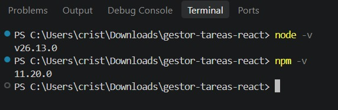

### 3.2. Creación del proyecto

Se utilizó Vite para crear el proyecto con la plantilla de React. Desde la terminal de Visual Studio Code se ejecutó:

```bash
npm create vite@latest . -- --template react
```

Durante la configuración se seleccionó ESLint como herramienta para revisar el código, y se aceptó instalar las dependencias e iniciar el servidor de desarrollo.

Resultado del proceso:

- Se instalaron 143 paquetes en 19 segundos.
- Vite inició el servidor local en 4,48 segundos.
- La aplicación se visualizó en el navegador en `http://localhost:5173/`.

Comandos de uso habitual:

```bash
npm install     # instala las dependencias
npm run dev     # inicia el servidor de desarrollo
```

### 3.3. Resultado de la instalación

La instalación finalizó correctamente y se visualizó la página inicial de React y Vite en el navegador.

Esto permitió comprobar que el entorno de desarrollo estaba funcionando y que los cambios realizados en el código podían reflejarse automáticamente en el navegador mediante HMR (Hot Module Replacement).

### 3.4. Tiempo de configuración inicial

| Medición | Resultado |
|---|---|
| Inicio | Ejecución del comando `npm create vite@latest . -- --template react` |
| Finalización | Primera ejecución exitosa de la aplicación en `http://localhost:5173/` |
| Tiempo total | Aproximadamente 3 a 6 minutos |


### 3.5. Evidencias de instalación

- `01-instalacion-react.png`: creación e instalación del proyecto con Vite.

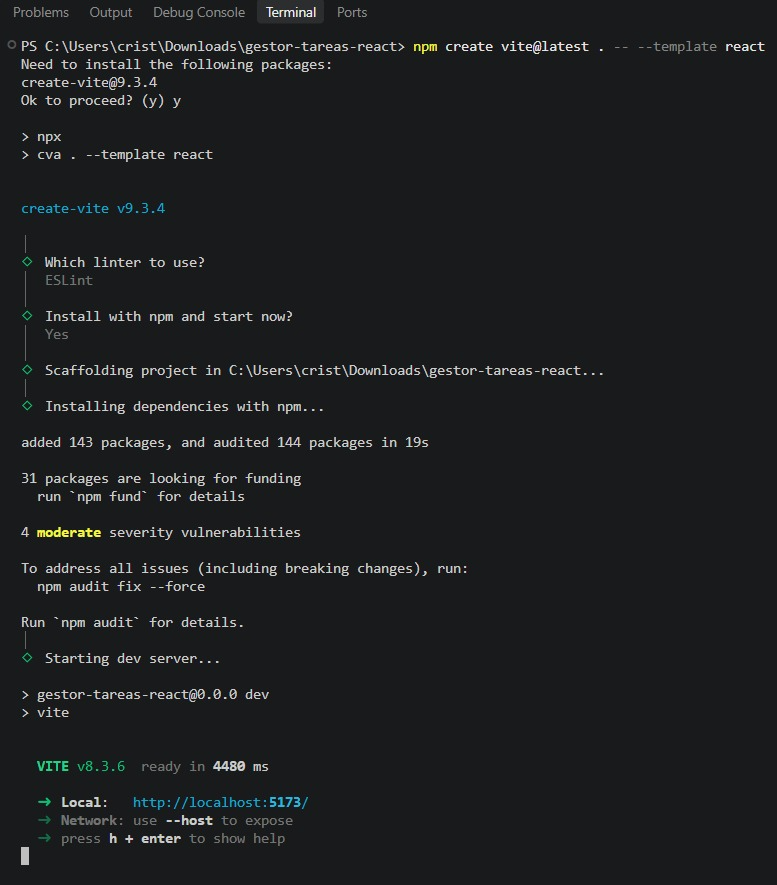

- `02-aplicacion-ejecutando.png`: aplicación inicial funcionando en el navegador.

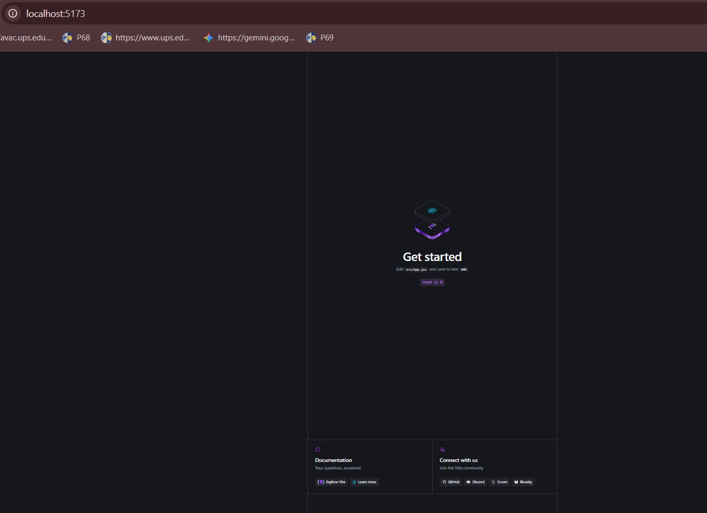

## 4. Estructura inicial del proyecto

El proyecto generado con Vite presenta una estructura organizada que separa los archivos principales de la aplicación, los estilos y los recursos estáticos.

```text
gestor-tareas-react/
├── docs/
│   └── evidencias/
├── public/
├── src/
│   ├── assets/
│   ├── App.jsx
│   ├── App.css
│   ├── index.css
│   └── main.jsx
├── .gitignore
├── eslint.config.js
├── index.html
├── package.json
├── package-lock.json
└── vite.config.js
```

### 4.1. Descripción de los archivos principales

| Archivo o carpeta | Función |
|---|---|
| `docs/evidencias/` | Guarda las capturas del proceso de desarrollo. |
| `public/` | Guarda recursos estáticos que se utilizan directamente. |
| `src/` | Contiene el código fuente de la aplicación. |
| `src/assets/` | Almacena imágenes y otros recursos utilizados por los componentes. |
| `App.jsx` | Contiene el componente principal de React. |
| `App.css` | Contiene los estilos del componente principal. |
| `index.css` | Define los estilos generales de la aplicación. |
| `main.jsx` | Es el punto de entrada que renderiza la aplicación React. |
| `index.html` | Contiene el documento HTML principal. |
| `package.json` | Define las dependencias y los comandos del proyecto. |
| `vite.config.js` | Contiene la configuración de Vite. |
| `eslint.config.js` | Configura las reglas de revisión del código. |

## 5. Hola mundo explicado

### 5.1. Recorrido general

```text
index.html  →  main.jsx  →  App.jsx
(div root)     (createRoot)   (componente)
```

1. El navegador abre `index.html`, que contiene un `<div id="root"></div>` vacío.
2. La etiqueta `<script type="module" src="/src/main.jsx">` carga el archivo `main.jsx`.
3. `main.jsx` toma el `root` y renderiza dentro el componente `<App />`.
4. `App.jsx` devuelve el JSX que se convierte en lo que se ve en pantalla.

### 5.2. `index.html`

| Línea | Explicación |
|---|---|
| `<meta charset="UTF-8" />` | Define la codificación de caracteres para mostrar tildes y la ñ correctamente. |
| `<meta name="viewport" ...>` | Hace que la página se adapte al ancho del dispositivo, necesario para el diseño responsive. |
| `<title>` | Texto que aparece en la pestaña del navegador. |
| `<div id="root"></div>` | Contenedor vacío donde React dibuja la aplicación. |
| `<script type="module" src="/src/main.jsx">` | Carga el punto de entrada de la aplicación como módulo. Vite se encarga de traducir el JSX para el navegador. |

### 5.3. `main.jsx`

| Línea | Explicación |
|---|---|
| `import { StrictMode } from 'react'` | Importa `StrictMode`, una herramienta de React (import nombrado, va entre llaves). |
| `import { createRoot } from 'react-dom/client'` | Importa la función que conecta React con el navegador. Está en `react-dom` porque React maneja los componentes y `react-dom` los dibuja en la página. |
| `import './index.css'` | Carga los estilos globales. |
| `import App from './App.jsx'` | Importa el componente principal (import por defecto, sin llaves). |
| `createRoot(document.getElementById('root'))` | Busca el `div` con id `root` y crea ahí la raíz de la aplicación. |
| `.render(<StrictMode><App /></StrictMode>)` | Dibuja `App` dentro de la raíz. `StrictMode` no se ve en pantalla: en desarrollo ayuda a detectar errores. |

### 5.4. `App.jsx` (plantilla inicial de Vite)

La explicación corresponde al `App.jsx` que genera Vite. Luego se reemplazó por el código propio del proyecto, descrito en las secciones 6 y 7.

| Elemento | Explicación |
|---|---|
| `function App() { ... }` | Un componente es una función que devuelve JSX. Su nombre empieza con mayúscula. |
| `export default App` | Permite que `main.jsx` importe el componente. |
| `const [count, setCount] = useState(0)` | `useState` crea un estado. `count` es el valor actual, `setCount` es la función para cambiarlo y `0` es el valor inicial. |
| `return ( <> ... </> )` | Devuelve el JSX, una sintaxis parecida al HTML dentro de JavaScript. `<>...</>` es un fragment: agrupa elementos sin crear un `div` extra. |
| `className` | En JSX se usa `className` en lugar de `class`, porque `class` es una palabra reservada de JavaScript. |
| `{count}` | Las llaves insertan una expresión de JavaScript dentro del JSX. |
| `onClick={() => setCount((count) => count + 1)}` | Evento de clic. Se pasa una función que actualiza el estado; al cambiar el estado, React vuelve a dibujar el componente con el nuevo valor. |
| `import heroImg from './assets/hero.png'` | Importa una imagen para poder usarla en el JSX. |


## 6. Bloque 3: Componentes

Un componente en React es una función que recibe datos y devuelve JSX, es decir, la parte de la interfaz que se muestra. Permite dividir la aplicación en piezas pequeñas y reutilizables.

### 6.1. Componentes de la aplicación

| Componente | Función |
|---|---|
| `TaskItem` | Muestra una tarea: título, estado y botón. |
| `TaskList` | Recibe un arreglo de tareas y muestra un `TaskItem` por cada una. |
| `TaskFilter` | Muestra los botones Todas, Pendientes y Hechas. |

### 6.2. Componente reutilizable: `TaskItem`

```jsx
function TaskItem({ titulo, completada }) {
  return (
    <li className="task-item">
      <span className={completada ? 'tachado' : ''}>{titulo}</span>
      <span>{completada ? 'Hecha' : 'Pendiente'}</span>
      <button type="button">Marcar como hecha</button>
    </li>
  )
}

export default TaskItem
```

`TaskItem` se usó tres veces con datos distintos:

```jsx
<TaskItem titulo="Leer documentación de React" completada={false} />
<TaskItem titulo="Crear el repositorio" completada={true} />
<TaskItem titulo="Hacer el componente TaskItem" completada={false} />
```

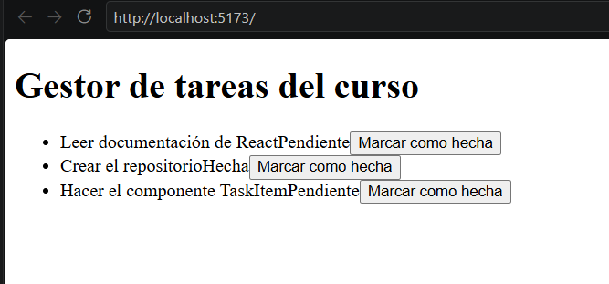

### 6.3. Temas del bloque

| Tema | Qué es y para qué sirve | Ejemplo propio |
|---|---|---|
| Componentes y JSX | Funciones que devuelven JSX, una sintaxis parecida al HTML dentro de JavaScript. | `TaskItem`, `TaskList` y `TaskFilter`. |
| Props | Datos que un componente recibe de quien lo usa. Permiten reutilizarlo con información distinta. | `TaskItem` recibe `titulo` y `completada`. |
| Renderizado condicional | Mostrar un contenido u otro según una condición. | `completada ? 'Hecha' : 'Pendiente'` y título tachado con la clase `tachado`. |
| Listas y `key` | Se recorre un arreglo con `.map()` para generar un componente por elemento. `key` identifica cada elemento. | `TaskList` usa `tareas.map(...)` con `key={tarea.id}`. |
| Eventos | Acciones del usuario, como un clic, que ejecutan una función. | `onClick={() => onCambiarFiltro('pendientes')}` en `TaskFilter`. |

### 6.4. Error encontrado: falta de `key`

Al crear `TaskList` sin la prop `key`, la consola mostró el error `Each child in a list should have a unique "key" prop`. Se solucionó agregando `key={tarea.id}` a cada `TaskItem`.

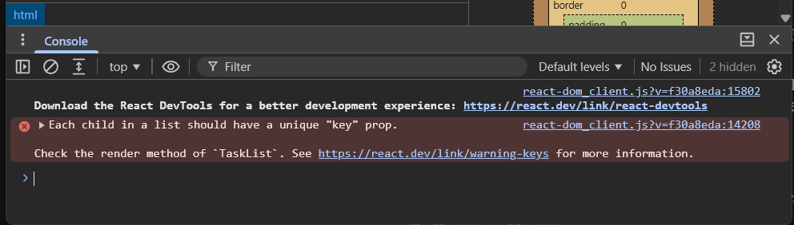

## 7. Bloque 4: Estado y reactividad

### 7.1. Estado con `useState`

El estado es la información que un componente recuerda y que, al cambiar, hace que React vuelva a dibujar la pantalla. En `App.jsx` se guarda el filtro actual:

```jsx
const [filtro, setFiltro] = useState('todas')
```

`filtro` es el valor actual, `setFiltro` es la función para cambiarlo y `'todas'` es el valor inicial. Al llamar a `setFiltro`, React actualiza la interfaz.

### 7.2. Estado compartido entre dos componentes

*Versión inicial del filtro, antes de conectar la API y el Context API (sección 10.7).*

El filtro lo cambia `TaskFilter` y lo necesita `TaskList`. Como ambos son hijos de `App`, el estado se guarda en `App` y se les pasa por props:

```jsx
function App() {
  const [filtro, setFiltro] = useState('todas')

  const tareasFiltradas = tareas.filter((tarea) => {
    if (filtro === 'pendientes') return !tarea.completada
    if (filtro === 'hechas') return tarea.completada
    return true
  })

  return (
    <div>
      <h1>Gestor de tareas del curso</h1>
      <TaskFilter filtroActual={filtro} onCambiarFiltro={setFiltro} />
      <TaskList tareas={tareasFiltradas} />
    </div>
  )
}
```

| Componente | Cómo participa |
|---|---|
| `App` | Guarda el estado `filtro` y calcula las tareas filtradas. |
| `TaskFilter` | Recibe `filtroActual` y la función `onCambiarFiltro`; avisa a `App` cuando se pulsa un botón. |
| `TaskList` | Recibe las tareas ya filtradas y las muestra. |

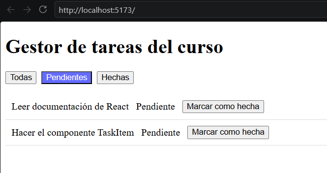

### 7.3. Diseño responsive

Se usaron reglas de CSS propio y una media query (`@media (max-width: 600px)`) para adaptar la aplicación a pantallas pequeñas.

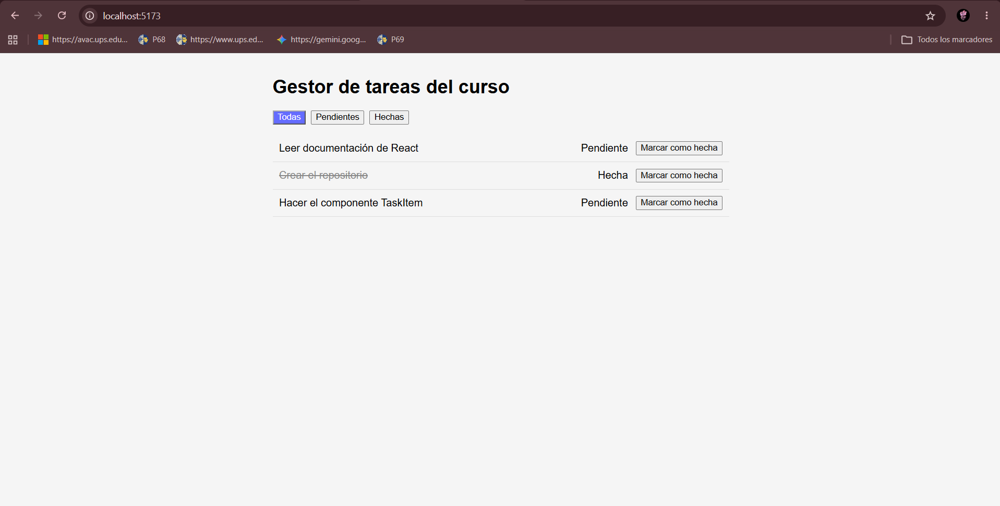

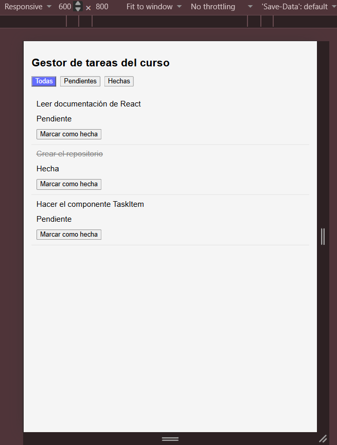

### 7.4. Estado global

El estado compartido se amplió con Context API para que cualquier componente acceda a las tareas, al filtro y a los estados de carga y error. La implementación se describe en la sección 10.7.

## 8. Registro de dificultades y soluciones

| Dificultad encontrada | Solución aplicada |
|---|---|
| Al ejecutar `git commit` inicialmente apareció `nothing to commit`. | Se identificó que la carpeta todavía no contenía archivos del proyecto. Se continuó con la creación de React mediante Vite. |
| Al finalizar `npm install` apareció el aviso de 4 vulnerabilidades moderadas. | Se ejecutó `npm audit` y se identificó que el origen era `minimatch@10.2.6` (denegación de servicio por patrones), que llega como dependencia de `eslint@10.14.0`, una herramienta solo de desarrollo. Con `npm audit --omit=dev` se comprobó que las dependencias de producción tienen 0 vulnerabilidades. No se aplicó `npm audit fix --force` porque instalaría una versión anterior de ESLint (cambio incompatible) y podría romper la configuración. Se decidió mantener las versiones actuales y volver a revisar con `npm audit` más adelante. |
| En la consola apareció el error `Each child in a list should have a unique "key" prop` al renderizar `TaskList` con `.map()`. | Se agregó la prop `key={tarea.id}` a cada `TaskItem`. React usa `key` para identificar cada elemento de la lista y saber cuál cambió, se agregó o se eliminó. Debe ser único entre hermanos y estable, por eso se usa el `id` de la tarea y no el índice del arreglo. |
| Al hacer commit, Git mostró `LF will be replaced by CRLF`. | Es una advertencia por la diferencia de saltos de línea entre sistemas (Windows usa CRLF, Linux y Mac usan LF). No afecta al código; se puede evitar con `git config core.autocrlf true`. |
| Tras hacer `git pull`, la aplicación mostró `Failed to resolve import "react-router-dom"`. | Las dependencias nuevas agregadas por otros integrantes no estaban instaladas en el equipo local, porque `node_modules` no se sube a Git. Se solucionó ejecutando `npm install`. |
| Al configurar las rutas, la aplicación mostró una pantalla negra y el error `Uncaught ReferenceError: Listado is not defined`. | Se solucionó importando explícitamente los componentes al inicio de `App.jsx` y corrigiendo la sintaxis física de los archivos, ya que React exige que los nombres de los componentes comiencen con letra mayúscula para no confundirlos con etiquetas HTML. |
| Al correr las pruebas unitarias, Vitest arrojó el error `TestingLibraryElementError: Found multiple elements` al encontrar textos duplicados. | Ocurrió porque los componentes no se desmontaban entre cada test. Se solucionó importando `cleanup` de `@testing-library/react` y ejecutándolo dentro de un bloque `afterEach()` para limpiar el DOM virtual. |

## 9. Fuentes de consulta

- [Documentación oficial de React](https://react.dev/)
- [Documentación oficial de Vite](https://vite.dev/)
- [Documentación de npm](https://docs.npmjs.com/)
- [Documentación de ESLint](https://eslint.org/)
- [Documentación de React Router](https://reactrouter.com/)
- [Documentación de Vitest](https://vitest.dev/guide/)
- [React Testing Library](https://testing-library.com/docs/react-testing-library/intro/)
- [Vite – Despliegue de sitios estáticos](https://vite.dev/guide/static-deploy)
- [React Basics: How & When to Use React Context (Telerik)](https://www.telerik.com/blogs/react-basics-how-when-use-react-context)
- [Deploy Vite React project with React Router without 404 on GitHub Pages (DEV Community)](https://dev.to/avithe1/deploy-vite-react-project-with-react-router-without-404-on-github-pages-h6p)


## 10. Bloques 4 y 5: Estado global, consumo de API y operaciones CRUD

### 10.1. Consumo de API con GET

Para obtener las tareas se utilizó la API pública JSONPlaceholder, que proporciona datos de prueba para desarrollar aplicaciones.

Se creó el archivo `src/services/tareasApi.js`, donde se implementó la función `obtenerTareas()` utilizando `fetch()`.

```javascript
const URL = 'https://jsonplaceholder.typicode.com/todos'

export async function obtenerTareas() {
  const respuesta = await fetch(`${URL}?_limit=10`)

  if (!respuesta.ok) {
    throw new Error('No se pudieron cargar las tareas')
  }

  const datos = await respuesta.json()

  return datos.map((tarea) => ({
    id: tarea.id,
    titulo: tarea.title,
    completada: tarea.completed,
  }))
}
```

Esta función permite obtener 10 tareas y adaptar los datos recibidos a la estructura utilizada en la aplicación.

**Evidencia del consumo de API:**

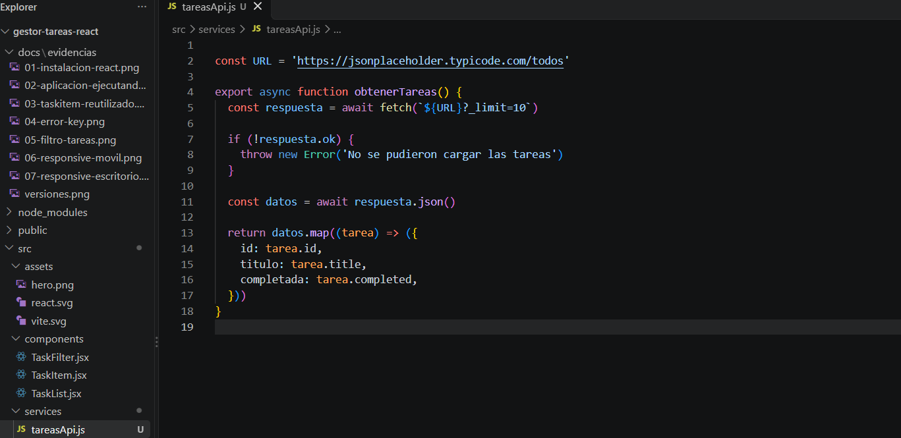

**Evidencia de las tareas obtenidas:**

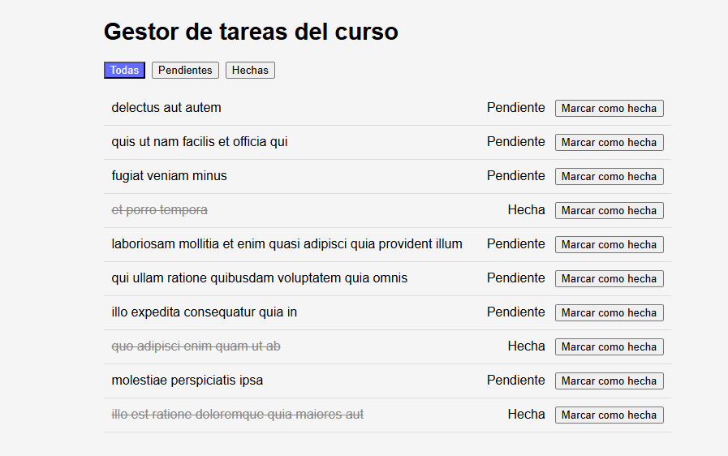

### 10.2. Manejo de carga y errores

Se implementaron estados de carga y error para controlar las peticiones realizadas a la API.

En `App.jsx` se utilizó `useEffect()` para ejecutar la consulta inicial y actualizar el estado de las tareas.

```jsx
useEffect(() => {
  obtenerTareas()
    .then((datos) => {
      setTareas(datos)
    })
    .catch((e) => {
      setError(e.message)
    })
    .finally(() => {
      setCargando(false)
    })
}, [setTareas, setError, setCargando])
```

Mientras se obtienen los datos se muestra el mensaje `Cargando tareas...`.

Si ocurre un problema durante la petición, la aplicación muestra un mensaje de error.

Para comprobar esta funcionalidad se utilizó temporalmente una dirección incorrecta de la API. Después de verificar el mensaje, se restauró la dirección original.

**Evidencia del manejo de errores:**

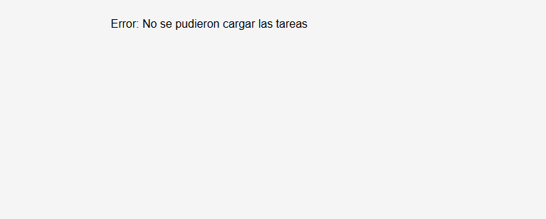

### 10.3. Creación de tareas con POST

Para registrar nuevas tareas se implementó el método POST mediante la función `crearTarea()`.

```javascript
export async function crearTarea(titulo) {
  const respuesta = await fetch(URL, {
    method: 'POST',
    headers: {
      'Content-Type': 'application/json',
    },
    body: JSON.stringify({
      title: titulo,
      completed: false,
      userId: 1,
    }),
  })

  if (!respuesta.ok) {
    throw new Error('No se pudo crear la tarea')
  }

  const datos = await respuesta.json()

  return {
    id: datos.id,
    titulo: datos.title,
    completada: datos.completed,
  }
}
```

También se creó el componente `TaskForm.jsx`, que permite ingresar el título de una tarea y agregarla mediante el botón **Agregar tarea**.

Cuando la petición se realiza correctamente, la nueva tarea se incorpora a la lista y aparece como pendiente.

**Evidencia de creación de tareas:**

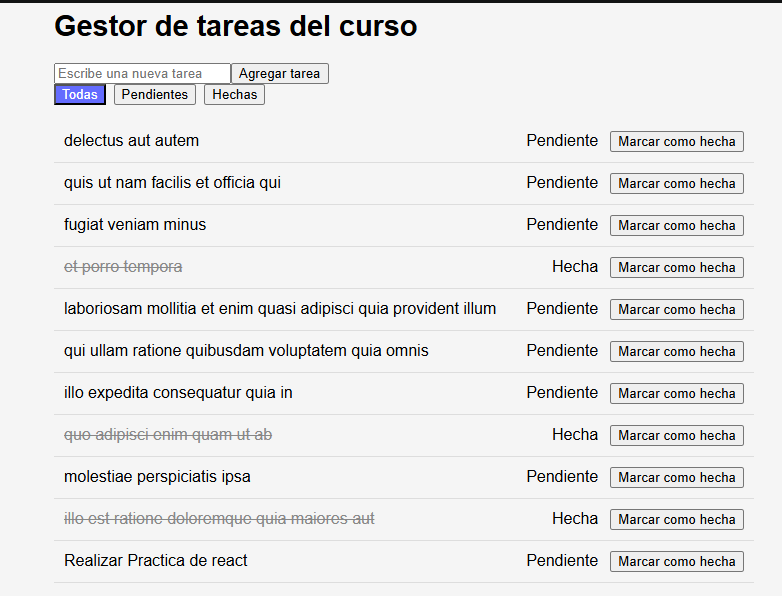

### 10.4. Edición de tareas con PUT

Se implementó la función `editarTarea()` para actualizar la información de una tarea utilizando el método PUT.

```javascript
export async function editarTarea(id, titulo, completada) {
  const respuesta = await fetch(`${URL}/${id}`, {
    method: 'PUT',
    headers: {
      'Content-Type': 'application/json',
    },
    body: JSON.stringify({
      id,
      title: titulo,
      completed: completada,
      userId: 1,
    }),
  })

  if (!respuesta.ok) {
    throw new Error('No se pudo editar la tarea')
  }

  const datos = await respuesta.json()

  return {
    id: datos.id,
    titulo: datos.title,
    completada: datos.completed,
  }
}
```

En `TaskItem.jsx` se agregó el botón **Editar**, que permite modificar el título de una tarea y guardar los cambios.

**Evidencia de edición de tareas:**


### 10.5. Cambio de estado de las tareas

Se implementó una función para cambiar las tareas entre los estados pendiente y hecha.

Para realizar el cambio se utiliza la función `editarTarea()` con el nuevo valor de `completada`.

```javascript
const nuevoEstado = !tareaActual.completada

if (typeof id === 'number' && id <= 200) {
  await editarTarea(
    id,
    tareaActual.titulo,
    nuevoEstado
  )
}

setTareas((anteriores) =>
  anteriores.map((tarea) =>
    tarea.id === id
      ? { ...tarea, completada: nuevoEstado }
      : tarea
  )
)
```

Cuando una tarea está completada, su título aparece tachado y el botón cambia a **Marcar como pendiente**.

**Evidencia del cambio de estado:**

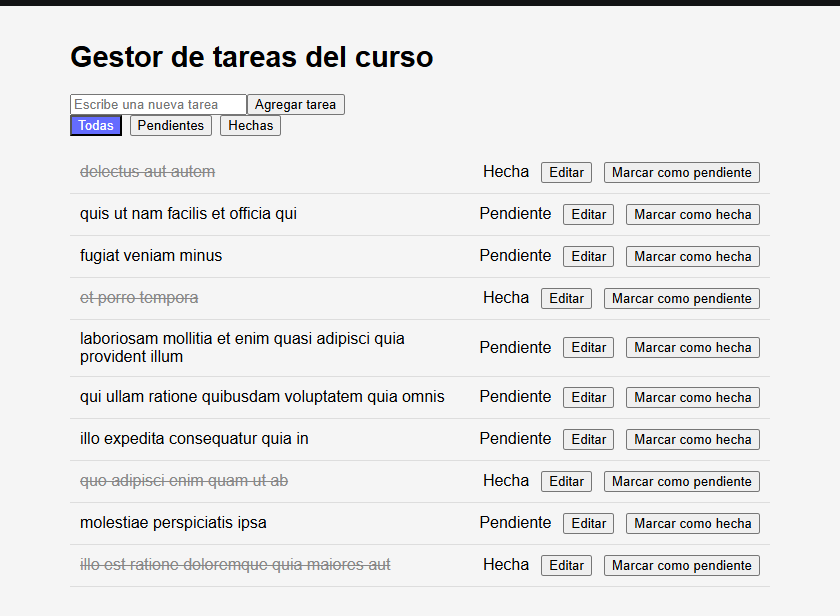

### 10.6. Eliminación de tareas con DELETE

Se implementó la función `eliminarTarea()` para realizar peticiones DELETE a JSONPlaceholder.

```javascript
export async function eliminarTarea(id) {
  const respuesta = await fetch(`${URL}/${id}`, {
    method: 'DELETE',
  })

  if (!respuesta.ok) {
    throw new Error('No se pudo eliminar la tarea')
  }

  return true
}
```

En `TaskItem.jsx` se incorporó el botón **Eliminar**. Antes de realizar la operación, se muestra una ventana de confirmación.

Después de confirmar la eliminación y completar correctamente la operación, la tarea desaparece de la lista.

**Evidencia de eliminación de tareas:**

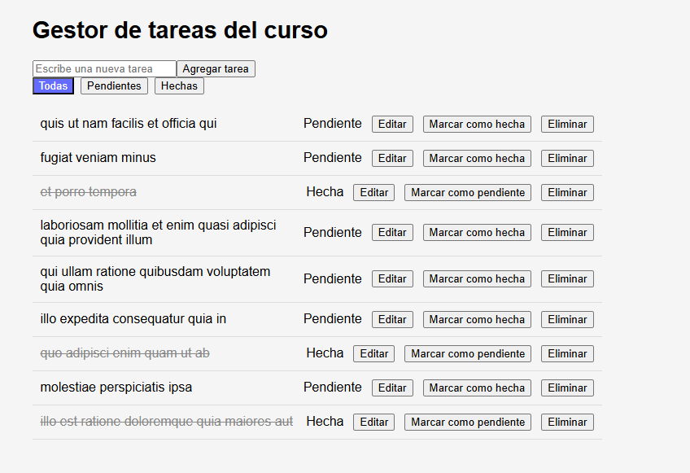

### 10.7. Estado global con Context API

Para compartir la información de las tareas entre los componentes se implementó Context API de React.

Se creó el archivo `src/context/TareasContext.jsx`, que contiene los estados principales de la aplicación.

```jsx
import { createContext, useContext, useState } from 'react'

const TareasContext = createContext(null)

export function TareasProvider({ children }) {
  const [tareas, setTareas] = useState([])
  const [cargando, setCargando] = useState(true)
  const [error, setError] = useState(null)
  const [errorFormulario, setErrorFormulario] = useState(null)
  const [guardando, setGuardando] = useState(false)
  const [filtro, setFiltro] = useState('todas')

  return (
    <TareasContext.Provider
      value={{
        tareas,
        setTareas,
        cargando,
        setCargando,
        error,
        setError,
        errorFormulario,
        setErrorFormulario,
        guardando,
        setGuardando,
        filtro,
        setFiltro
      }}
    >
      {children}
    </TareasContext.Provider>
  )
}

export function useTareas() {
  const contexto = useContext(TareasContext)

  if (!contexto) {
    throw new Error(
      'useTareas debe usarse dentro de TareasProvider'
    )
  }

  return contexto
}
```

En `main.jsx` se incorporó `TareasProvider` para envolver el componente principal `App`.

Posteriormente, `App.jsx` comenzó a utilizar `useTareas()` para acceder a los estados compartidos.

De esta manera, la información de las tareas, los filtros, los errores y los procesos de carga puede compartirse entre componentes.

**Evidencia de implementación de Context API:**

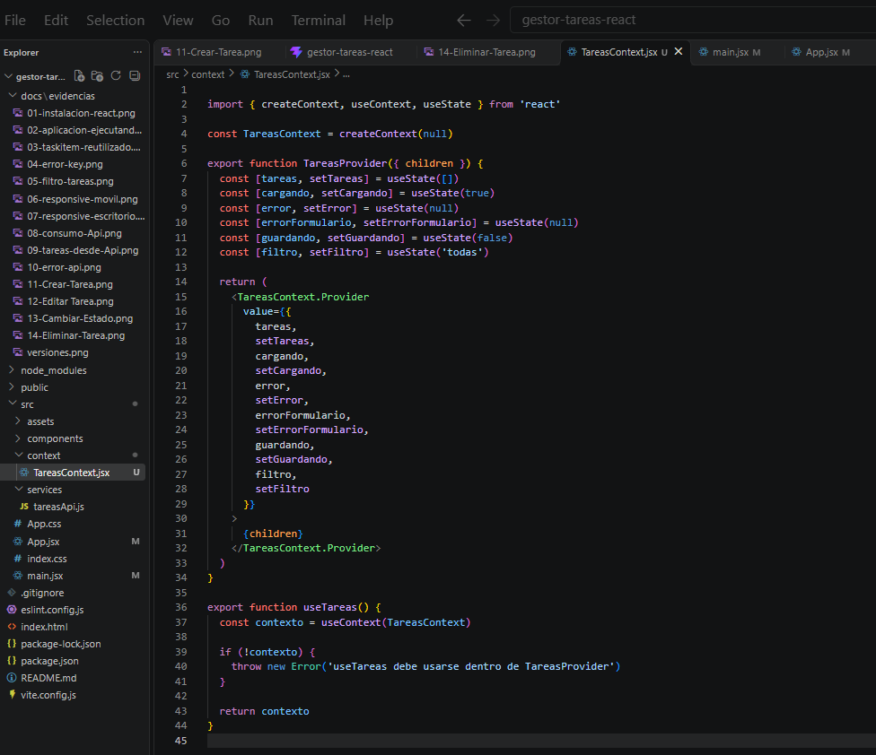

### 10.8. Resultados obtenidos

Durante el desarrollo se implementaron y comprobaron las siguientes funcionalidades:

| Funcionalidad | Resultado |
|---|---|
| GET | Obtención de tareas desde JSONPlaceholder. |
| POST | Creación de nuevas tareas. |
| PUT | Edición de títulos de tareas. |
| PUT | Cambio de estado entre pendiente y hecha. |
| DELETE | Eliminación de tareas de la lista. |
| Context API | Administración del estado compartido de la aplicación. |
| Manejo de carga | Visualización de un mensaje durante la consulta. |
| Manejo de errores | Presentación de mensajes cuando falla una operación. |
| Filtros | Visualización de todas las tareas, pendientes o hechas. |

JSONPlaceholder simula las operaciones POST, PUT y DELETE, por lo que los cambios no se guardan permanentemente en su servidor. La aplicación mantiene las modificaciones en el estado de React durante la sesión.

### 10.9. Control de versiones

El desarrollo de estas funcionalidades se realizó en la rama `feature/api-crud`.

Se registraron los avances mediante commits y posteriormente se subieron al repositorio de GitHub.

También se creó un Pull Request dirigido a la rama `main` para integrar el trabajo al proyecto compartido.

### 10.10. Fuentes de consulta

- [Documentación oficial de React](https://react.dev/)
- [React – createContext](https://react.dev/reference/react/createContext)
- [React – useContext](https://react.dev/reference/react/useContext)
- [React – useEffect](https://react.dev/reference/react/useEffect)
- [MDN – Fetch API](https://developer.mozilla.org/es/docs/Web/API/Fetch_API)
- [JSONPlaceholder](https://jsonplaceholder.typicode.com/)


## 11. Rutas, Pruebas y Despliegue
### 11.1 Enrutamiento dinámico con React Router
Para manejar la navegación sin recargar la página, se implementó la librería `react-router-dom`. La aplicación se envolvió en un componente `<BrowserRouter>` configurado con el `basename="/gestor-tareas-react"` para asegurar compatibilidad con el subdirectorio de GitHub Pages.

Se definieron dos rutas principales mediante `<Routes>`:
* **Ruta principal (`/`):** Renderiza la vista general con la lista de tareas, el formulario y los filtros.
* **Ruta detalle (`/detalle/:id`):** Renderiza el componente `Detalle.jsx`, el cual utiliza el hook `useParams()` para capturar el identificador dinámico de la URL, buscar la tarea específica en el estado global (`useTareas`) y mostrar información ampliada.

En cada elemento de la lista (`TaskItem.jsx`) se incorporó un componente `<Link>` que dirige dinámicamente a los detalles de cada tarea, mejorando la experiencia de usuario (UX).

### 11.2. Pruebas Unitarias con Vitest
Se configuró un entorno de pruebas unitarias utilizando **Vitest** y **React Testing Library**. Se implementaron tests para verificar el correcto renderizado de la interfaz y la presencia de los elementos principales.

Durante la ejecución, se detectó un problema de duplicación de elementos en el DOM virtual que provocaba fallos (`TestingLibraryElementError: Found multiple elements`). Para solucionarlo, se importó el método `cleanup` y se ejecutó dentro de un bloque `afterEach()` en el archivo de configuración, garantizando que el entorno se limpie entre cada prueba. Las pruebas unitarias finalizaron exitosamente (3/3 en verde).

### 11.3. Despliegue a producción en GitHub Pages
Para que la aplicación sea accesible públicamente, se configuró el despliegue automático mediante el paquete `gh-pages`.

El proceso consistió en:
1. Configurar la propiedad `base: '/gestor-tareas-react/'` en el archivo `vite.config.js`.
2. Agregar los scripts `predeploy` (para ejecutar `npm run build`) y `deploy` (para subir la carpeta `dist`) en el archivo `package.json`.
3. Ejecutar el comando de despliegue, el cual generó los archivos estáticos optimizados y los envió a la rama `gh-pages` del repositorio.

**URL pública de la aplicación:** https://cristinaelilo.github.io/gestor-tareas-react/

## 12. Mediciones Técnicas Globales
| Métrica | Cómo medirla | Resultado |
| :--- | :--- | :--- |
| Tiempo de configuración inicial (min) | Desde instalar hasta ver corriendo | 3 a 6 minutos |
| Líneas de código (LOC) | `npx cloc src` o conteo manual | ~40 líneas (Módulo de rutas y detalle) |
| Tamaño del build de producción (KB) | Carpeta dist tras el build | JS: 257.95 kB / CSS: 1.78 kB |
| Puntaje de rendimiento Lighthouse | Chrome Dev Tools, modo móvil | 96/100 (Performance) |
| Horas totales del grupo | Registro de horas por integrante | 18 horas |
| Dificultad percibida (1 a 5) | Promedio de los integrantes | 3.8/5 |

### 12.1. Registro por integrante

| Integrante | Horas | Dificultad (1 a 5) |
|---|---|---|
| Cristina Loja | 6 | 3|
| Denisse Paredes | 6 | 4|
| Brandon | 6 | 4.5 |
| **Total / promedio** | **18** | **3.8** |


## 13. Uso de IA
En este proyecto utilizamos Inteligencia Artificial (Gemini / ChatGPT) estrictamente como compañera de estudio y asistencia técnica, verificando cada solución con la documentación oficial de React y Vite, cumpliendo con los lineamientos de la rúbrica:

* **Comprensión de conceptos:** Se utilizó para entender el flujo de datos del `Context API` y cómo integrarlo sin romper la lógica del CRUD existente.
* **Resolución de errores (Debugging):** 
  * *Prompt de ejemplo:* "Me sale el error 'TestingLibraryElementError: Found multiple elements' al correr mis tests en Vitest. ¿Cómo limpio el DOM virtual entre cada prueba?"
  * *Solución aplicada:* Nos guio para implementar el método `cleanup` dentro de un `afterEach()` en el entorno de pruebas.
* **Configuración de Despliegue:** Se consultó la forma correcta de configurar la propiedad `base` en `vite.config.js` y el `basename` en `react-router-dom` para evitar el error 404 al subir la app a GitHub Pages en un subdirectorio.

### 13.1. NotebookLM

Se creó un cuaderno de grupo con 16 fuentes: la documentación oficial de React (*Your First Component*, *Passing Props*, *Conditional Rendering*, *Rendering Lists*, *State: A Component's Memory*, *Sharing State Between Components*, *Passing Data Deeply with Context* y *Synchronizing with Effects*), la documentación de React Router, Vitest, React Testing Library, Vite (despliegue) y MDN (Fetch API), dos artículos técnicos (Telerik y DEV Community) y el README de este repositorio.

**Enlace al cuaderno:** https://notebook.google.com/notebook/2a781854-dfe3-440f-91d8-9f1af3dff7fd

Con el cuaderno se generó una guía de estudio en español con el siguiente prompt:

> "Genera una guía de estudio en español sobre React basada en mis fuentes. Incluye: conceptos clave (componentes, props, estado, useEffect, Context API, React Router, pruebas y despliegue), un glosario de términos y 10 preguntas de repaso con sus respuestas."

Además, se le hicieron preguntas sobre temas del proyecto, revisando las citas que indica cada respuesta en la fuente original:

| Pregunta al cuaderno | Resumen de la respuesta | Fuente donde se verificó |
|---|---|---|
| ¿Cuándo conviene usar Context API en lugar de pasar props? | Conviene cuando varios componentes en distintos niveles necesitan los mismos datos (usuario, tema, idioma, ruta), para evitar el *prop drilling*. Si los datos solo pasan de padre a hijo, es mejor usar props. | *Passing Data Deeply with Context* (react.dev) y artículo de Telerik |
| ¿Para qué sirve `cleanup` en las pruebas con React Testing Library? | Desmonta los componentes renderizados y limpia el DOM virtual entre pruebas, evitando errores por elementos duplicados como `Found multiple elements`. Se ejecuta dentro de un `afterEach()`. | Documentación de React Testing Library |
| ¿Por qué es necesaria la prop `key` al renderizar listas con `map`? | Identifica de forma única cada elemento para que React detecte qué cambió, se agregó o se eliminó, y conserve el estado local. Debe ser estable y única; no conviene usar el índice del arreglo. | *Rendering Lists* (react.dev) |

También se consultó sobre el uso de `basename` en React Router, el arreglo de dependencias de `useEffect` y la diferencia entre props y estado.

**Evidencias del cuaderno:**

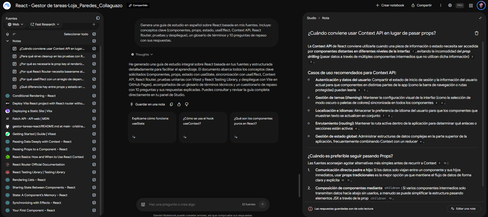

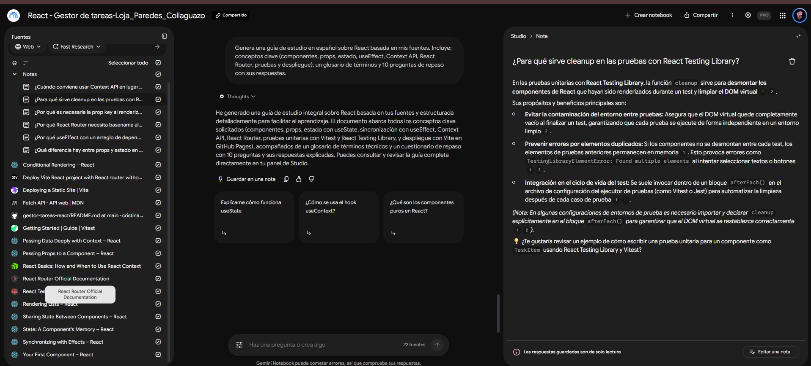

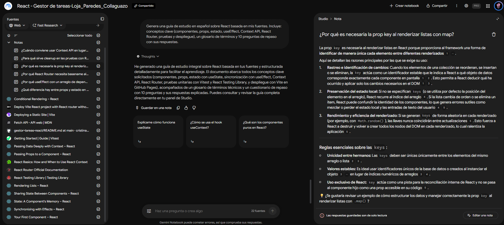